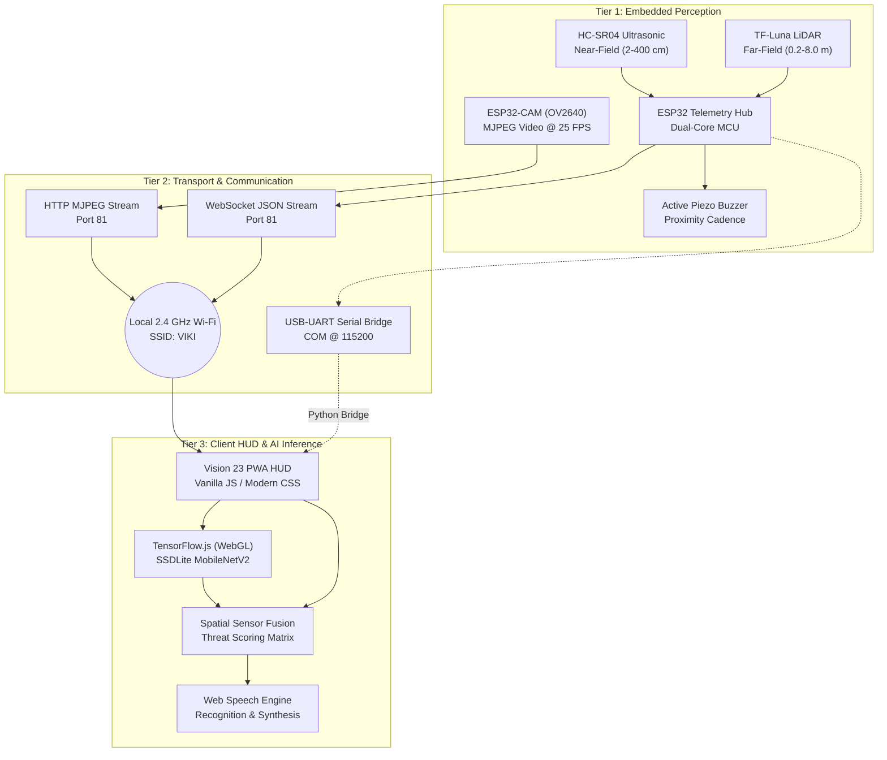

# VISION 23 / NAV-BOT

> **Real-Time Embedded Robotics Perception, Computer Vision & Sensory Telemetry Platform**  
> *ECE Final Year Engineering Project*

---

## Overview

**Vision 23 (Nav-Bot)** is an assistive navigation and obstacle avoidance system engineered for low-latency spatial perception. Designed for robotic platforms and assistive navigation systems, it integrates:

- **Optical Computer Vision**: Real-time object detection and classification running directly in the browser via TensorFlow.js.
- **Time-of-Flight (ToF) LiDAR Ranging**: Precision forward distance measurement from 0.2 m to 8.0 m using a TF-Luna sensor.
- **Acoustic Ultrasonic Ranging**: Near-field obstacle detection from 2 cm to 400 cm using an HC-SR04 sensor.
- **Multi-Modal Spatial Threat Assessment**: Real-time fusion engine correlating visual bounding boxes with distance vectors.
- **Hands-Free Audio UI**: Two-way voice command recognition and text-to-speech audio guidance tailored for Bluetooth headsets.
- **100% Offline Capability**: Runs entirely on a local network with pre-cached neural network weights and Progressive Web App (PWA) architecture.

---

## System Architecture

The project is structured into three distinct operational tiers:



---

## Repository Structure

```
robot-nav/
├── .gitattributes            # Line endings and binary attribute definitions
├── .gitignore                # Excludes OS, editor, and build artifacts
├── README.md                 # Project documentation and setup guide
├── index.html                # Heads-up display (HUD) application entrypoint
├── manifest.json             # Progressive Web App manifest
├── requirements.txt          # Python dependencies for serial bridge
├── sw.js                     # Offline caching service worker
├── api/
│   ├── discover.php          # Network interface and ESP32 auto-discovery endpoint
│   └── README.md             # API documentation
├── assets/
│   ├── favicon.ico           # Application favicon
│   ├── icon-192.png          # PWA 192x192 icon
│   ├── icon-512.png          # PWA 512x512 icon
│   └── logo.svg              # Vector logo asset
├── bridge/
│   ├── esp32_serial_stream.py # USB serial-to-HTTP MJPEG proxy
│   ├── requirements.txt      # Bridge-specific dependencies
│   └── README.md             # Bridge usage instructions
├── css/
│   └── style.css             # Cyberpunk HUD interface styling
├── docs/
│   ├── API_REFERENCE.md      # Detailed REST and WebSocket API schemas
│   ├── HARDWARE_SETUP.md     # Pinout diagrams, schematics, and power guidelines
│   ├── SYSTEM_ARCHITECTURE.md# Comprehensive technical specification
│   └── Vision_23_System_Architecture.docx # Project architecture document
├── firmware/
│   ├── esp32_navbot_firmware.ino # ESP32 Arduino C++ firmware
│   └── README.md             # Flashing instructions and board configurations
├── js/
│   ├── app.js                # Lifecycle management, HUD binding, and simulation
│   ├── path_history.js       # Trajectory breadcrumbs and obstacle logging
│   ├── state.js              # Central reactive state manager
│   ├── telemetry.js          # WebSocket client and telemetry parser
│   ├── vision.js             # TensorFlow.js pipeline and bounding box tracker
│   ├── voice.js              # Speech recognition and audio synthesis
│   └── README.md             # Frontend module documentation
└── vendor/
    ├── coco-ssd.min.js       # COCO-SSD object detection bundle
    ├── tf.min.js             # TensorFlow.js core runtime
    ├── README.md             # Vendor libraries description
    └── models/
        └── ssdlite_mobilenet_v2/ # Offline GraphModel and weight shards
```

---

## Hardware Connections Summary

| Component | ESP32 Pin | Protocol | Notes |
| :--- | :--- | :--- | :--- |
| **HC-SR04 Trig** | `GPIO 13` | Digital Output | 10 µs trigger pulse |
| **HC-SR04 Echo** | `GPIO 14` | Digital Input | Stepped down 5V $\rightarrow$ 3.3V with 1kΩ / 2kΩ divider |
| **TF-Luna LiDAR RX** | `GPIO 17` | UART2 TX | Serial communication |
| **TF-Luna LiDAR TX** | `GPIO 16` | UART2 RX | Receives 9-byte binary distance frames |
| **Active Buzzer** | `GPIO 4` | PWM / Digital | Audible proximity feedback |
| **ESP32-CAM OV2640** | DVP Bus | Parallel | Video streaming @ 640x480 resolution |

For full schematics and brownout prevention tips, consult [docs/HARDWARE_SETUP.md](docs/HARDWARE_SETUP.md).

---

## Quick Start

### 1. Flash the Firmware
1. Open `firmware/esp32_navbot_firmware.ino` in Arduino IDE.
2. Configure your 2.4 GHz Wi-Fi SSID and password in lines 29–30.
3. Select **AI Thinker ESP32-CAM** (or **ESP32 Dev Module**) with **Huge APP** partition scheme.
4. Upload to the microcontroller. See [firmware/README.md](firmware/README.md).

### 2. Host the Web Application
Place the `robot-nav` folder inside your local web server root (e.g., `C:/xampp/htdocs/robot-nav`).

Start Apache in XAMPP and navigate to:
```
http://localhost/robot-nav/
```

### 3. Optional: Run the Serial Bridge (Wired Mode)
If operating without Wi-Fi, stream video over USB:
```bash
cd bridge
pip install -r requirements.txt
python esp32_serial_stream.py --port COM22 --baud 115200
```
In the web dashboard, configure the camera stream to `http://localhost:8080/stream`.

### 4. Simulation Mode
The web dashboard includes a built-in sensor and virtual video generator. Toggle **Simulation Mode** from the top bar to evaluate the HUD without physical hardware connected.

---

## Multi-Modal Threat Assessment

Distance readings are fused dynamically to classify navigational threats:

| Threat Zone | Distance | Actions |
| :--- | :--- | :--- |
| **DANGER** | $\le 35\text{ cm}$ | Red HUD Reticle, urgent banner alert, continuous buzzer ($\le 15\text{ cm}$), haptic pulse, vocal stop alert |
| **CAUTION** | $35\text{ cm} < D \le 80\text{ cm}$ | Amber HUD, medium-cadence beep, vocal slowdown guidance |
| **CLEAR** | $> 80\text{ cm}$ | Green HUD, buzzer idle, spoken clear confirmation |

---

## Documentation Links

- [System Architecture Specification](docs/SYSTEM_ARCHITECTURE.md)
- [Hardware Wiring & Schematics](docs/HARDWARE_SETUP.md)
- [API & Protocol Reference](docs/API_REFERENCE.md)
- [ESP32 Firmware Instructions](firmware/README.md)
- [Python Serial Bridge Guide](bridge/README.md)
- [Auto-Discovery Service Details](api/README.md)
- [JavaScript Modules Guide](js/README.md)
- [Vendor & Model Weights Reference](vendor/README.md)
