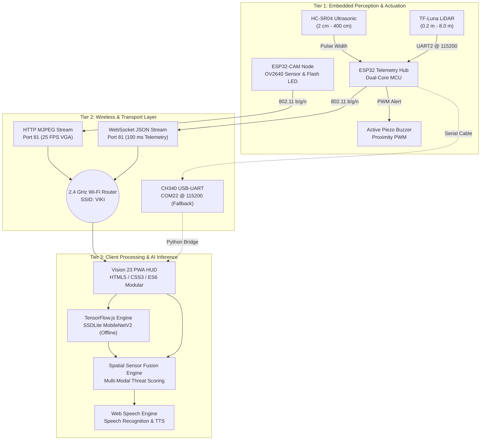

# VISION 23 / NAV-BOT: System Architecture Specification

> **ECE Final Year Engineering Project**  
> **Real-Time Robotics Perception, Computer Vision & Sensory Telemetry Architecture**

---

## 1. Executive Summary & System Overview

The **Vision 23 / Nav-Bot** architecture is an ultra-low-latency robotic obstacle detection, spatial awareness, and assistive navigation platform. Designed for high reliability in mobile robotics and assistive navigation for visually impaired individuals, Vision 23 couples optical computer vision, solid-state time-of-flight (ToF) LiDAR ranging, and ultrasonic acoustic depth sensing.

Sensory acquisition is decoupled across dedicated **ESP32** microcontroller nodes. These nodes transmit high-throughput telemetry and live video streams over an **802.11 b/g/n wireless network** to a Progressive Web Application (PWA) running locally on an Apache/XAMPP server. Neural network object detection runs **100% locally and offline** directly inside the client browser using WebGL GPU-accelerated **TensorFlow.js (SSDLite MobileNetV2)**.



---

## 2. System Architecture Tiers

The system is partitioned into three decoupled tiers to guarantee deterministic real-time response, high throughput, and fault tolerance:

### Tier 1: Embedded Hardware & Perception Layer
- **ESP32-CAM (AI-Thinker)**: Dedicated to high-throughput frame acquisition. Operates the OmniVision OV2640 image sensor over a DVP parallel bus, streaming 640x480 (VGA) resolution JPEG frames at 25 frames per second. Includes an onboard high-power white Flash LED on GPIO 4 for dark-environment illumination.
- **ESP32 Telemetry Hub**: Dedicated dual-core MCU handling high-frequency hardware interrupts and serial buses. Reads the HC-SR04 ultrasonic rangefinder and TF-Luna LiDAR sensor at 100 ms intervals.
- **Active Piezo Buzzer**: Driven directly by the Telemetry Hub on GPIO 4 with a variable PWM cadence inversely proportional to target obstacle distance.

### Tier 2: Wireless & Transport Communication Layer
- **Local WLAN (SSID: VIKI)**: IEEE 802.11 b/g/n (2.4 GHz) managed local network ensuring low round-trip latency (< 8 ms).
- **HTTP MJPEG Video Stream (`http://10.213.173.152:81/stream`)**: Continuous multipart HTTP stream (`multipart/x-mixed-replace; boundary=frame`) directly consumable by browser `` or `<canvas>` tags.
- **Bidirectional WebSocket Telemetry (`ws://10.213.173.74:81`)**: Asynchronous, event-driven JSON telemetry broadcast yielding a 10 Hz telemetry refresh rate.
- **USB Serial Fallback Bridge (`bridge/esp32_serial_stream.py`)**: Python-based proxy converting raw USB-UART serial packets (CH340 COM port @ 115200 baud) into a localhost MJPEG HTTP stream on port 8080 when Wi-Fi is unavailable or during lab bench testing.

### Tier 3: Client Processing, AI Inference & User Interface Layer
- **Progressive Web Application (PWA)**: Hosted via local XAMPP Apache with full service worker caching (`sw.js`) and offline manifest (`manifest.json`).
- **TensorFlow.js Object Detection**: Runs offline inference using pre-bundled SSDLite MobileNetV2 weights (`vendor/models/ssdlite_mobilenet_v2/`). Detects people, vehicles, obstacles, chairs, and 80+ COCO classes directly on device GPU (WebGL).
- **Spatial Threat Matrix & Sensor Fusion**: Real-time fusion correlates camera bounding box geometry with depth ranging data from LiDAR and Ultrasonic sensors.
- **Hands-Free Two-Way Voice Protocol**: Integrates W3C Web Speech Recognition and Speech Synthesis APIs, optimized for Bluetooth earbuds.

---

## 3. Hardware Specifications & Pinout Reference

| Node / Subsystem | Perception Component | Physical Pin / Port | Interface Protocol | Operational Function |
| :--- | :--- | :--- | :--- | :--- |
| **ESP32 Sensor Hub** | HC-SR04 Ultrasonic | Trig: `GPIO 13`<br/>Echo: `GPIO 14` | Digital Pulse (10 µs trigger) | Short/medium ranging (2 cm – 400 cm). *Note: 5V Echo stepped down to 3.3V via voltage divider.* |
| **ESP32 Sensor Hub** | TF-Luna LiDAR | RXD2: `GPIO 16`<br/>TXD2: `GPIO 17` | UART2 @ 115200 Baud | High-precision ToF ranging (0.2 m – 8.0 m) via 9-byte binary packets. |
| **ESP32 Sensor Hub** | Active Piezo Buzzer | `GPIO 4` | Digital Output / PWM | Proximity alarm with cadence inversely proportional to obstacle distance. |
| **ESP32 Sensor Hub** | USB Serial Console | Micro-USB (CH340) | COM22 @ 115200 Baud | Serial debug output, diagnostics, and wired fallback streaming. |
| **ESP32-CAM Node** | OV2640 Image Sensor | D0–D7, VSYNC, HREF, PCLK | DVP Parallel Bus | Video capture at 640x480 (VGA) @ 25 FPS. |
| **ESP32-CAM Node** | Onboard Flash LED | `GPIO 4` | Digital Output | Illuminates dark/nighttime navigation paths. |

---

## 4. Network Topology & Transport Protocols

```
+---------------------------------------------------------------------------------+
|                                 Router (VIKI)                                   |
|                             Gateway: 10.213.173.41                              |
|                             Subnet: 10.213.173.0/24                             |
+---------------------------------------------------------------------------------+
          |                                  |                           |
          v                                  v                           v
+-----------------------+        +-----------------------+      +-----------------------+
|    ESP32-CAM Node     |        |   ESP32 Sensor Hub    |      |    Host PC / Phone    |
|     10.213.173.152    |        |     10.213.173.74     |      |     10.213.173.5      |
|                       |        |                       |      |                       |
| Port 81: MJPEG Stream |        | Port 81: WebSocket    |      | Port 80: XAMPP Apache |
| Port 80: Web Config   |        | COM22: Serial 115200  |      | PWA / TF.js Inference |
+-----------------------+        +-----------------------+      +-----------------------+
```

### Auto-Discovery Service (`api/discover.php`)
When the client boots up on a new or dynamically assigned network, `api/discover.php` inspects the local host ARP cache and network interface table. It matches known Espressif MAC address Organizationally Unique Identifiers (OUIs):
- `30:76:f5`
- `b4:bf:e9`
- `24:0a:c4`
- `48:e7:29`
- `dc:54:75`
- `ac:67:b2`
- `a4:cf:12`

It automatically resolves and binds the active camera URL and telemetry WebSocket endpoint without manual configuration.

---

## 5. Telemetry Data Formats & Schemas

The ESP32 Telemetry Hub broadcasts JSON payloads over WebSocket port 81 every 100 ms:

### Individual Sensor Broadcasts
```json
// LiDAR Distance Broadcast (centimeters)
{
  "sensor": "LiDAR",
  "distance": 206
}

// Ultrasonic Distance Broadcast (centimeters)
{
  "sensor": "Ultrasonic",
  "distance": 155
}
```

### Aggregated Telemetry Frame
```json
{
  "ultrasonic": 155.0,
  "lidar": 206.0,
  "signal": 94,
  "timestamp": 1730000000000
}
```

---

## 6. Threat Assessment & Spatial Safety Matrix

Vision 23 executes multi-modal sensor fusion by comparing the detected object classification bounding box from TensorFlow.js with the distance readings from the LiDAR and ultrasonic sensors:

$$D_{\text{fused}} = \min(D_{\text{LiDAR}}, D_{\text{Ultrasonic}})$$

| Safety Classification | Distance Threshold ($D_{\text{fused}}$) | System Response & Multi-Modal Feedback |
| :--- | :--- | :--- |
| **DANGER ZONE** | $D_{\text{fused}} \le 35\text{ cm}$ | • **HUD**: Flashing Red Crosshair & Hazard Banner<br/>• **Buzzer**: Continuous high-frequency tone ($\le 15\text{ cm}$)<br/>• **Haptics**: 80 ms pulsed vibration on mobile device<br/>• **Audio**: Urgent synthetic warning: *"Stop! Obstacle immediate."* |
| **CAUTION ZONE** | $35\text{ cm} < D_{\text{fused}} \le 80\text{ cm}$ | • **HUD**: Amber Warning Crosshair<br/>• **Buzzer**: Medium-rate pulsed beep cadence<br/>• **Audio**: Navigation guidance: *"Caution, obstacle ahead, slow down."* |
| **CLEAR / SAFE** | $D_{\text{fused}} > 80\text{ cm}$ | • **HUD**: Green Safe Reticle<br/>• **Buzzer**: Silent / Standby<br/>• **Audio**: *"Path clear. Maintain heading."* |

---

## 7. Voice Interaction & Earbuds Hands-Free Protocol

For hands-free operation (e.g., visually impaired user guidance or field robotics control), Vision 23 implements bidirectional voice communication through the Web Speech API:

| Voice Trigger Command | Processing Logic | Text-to-Speech Response |
| :--- | :--- | :--- |
| `"What is the distance to the next object?"` | Queries latest $D_{\text{fused}}$ reading from the reactive state store. | *"Nearest obstacle is [X] centimeters ahead."* |
| `"What is the next object?"` | Queries the on-device SSDLite MobileNetV2 vision engine for the highest-confidence bounding box. | *"[Class Name], [X] meters ahead in your [left / center / right] path."* |
| `"Is the path clear?"` | Evaluates threat state across all sensor channels and bounding box regions. | *"Path is clear. No obstacles within 1 meter."* or *"Caution, obstacle detected ahead."* |
| `"Repeat warning"` | Retrieves the last critical alert from the event log buffer. | *Re-announces the latest hazard warning and distance.* |

---

## 8. Offline PWA Architecture & Service Worker Caching

Vision 23 guarantees zero-cloud dependency:
1. **Model Bundling**: The SSDLite MobileNetV2 model architecture (`model.json`) and 5 weight shards (`group1-shard1of5` through `group1-shard5of5`, total ~17.5 MB) reside in `vendor/models/ssdlite_mobilenet_v2/`.
2. **Local Pre-caching**: `sw.js` pre-caches all CSS, JS, HTML, and model shards on first launch.
3. **Stream Passthrough**: Dynamic MJPEG video streams, WebSocket frames, and PHP discovery requests bypass the service worker cache to ensure zero latency overhead.
