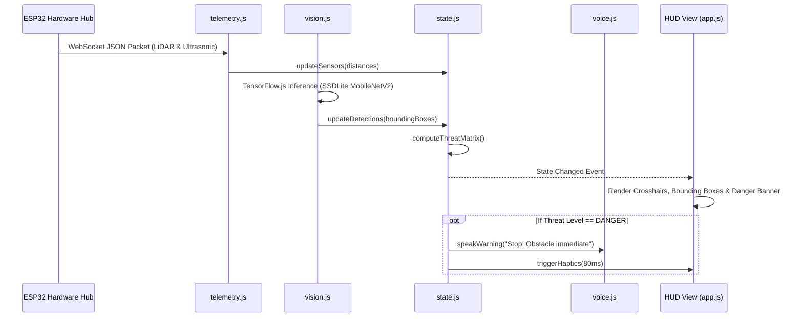

# Vision 23: JavaScript Architecture & Core Modules

The `js/` directory houses the modular, vanilla JavaScript architecture that powers the Vision 23 Progressive Web Application HUD. It relies on standard modern ES6+ features with zero heavy bundler or framework dependencies.

---

## 1. Module Overview

| File | Module Name | Responsibilities |
| :--- | :--- | :--- |
| `state.js` | **Central State Store** | Manages application state, sensor telemetry, detection lists, threat zones, user preferences, and reactive listener subscriptions. |
| `telemetry.js` | **Telemetry Streamer** | Manages WebSocket connections (`ws://<ip>:81`) to the ESP32 Hub, handles reconnection logic, parses JSON packets, and falls back to HTTP polling. |
| `vision.js` | **Vision & Inference Engine** | Initializes TensorFlow.js (`tf.min.js`) and COCO-SSD (`coco-ssd.min.js`), manages video canvas rendering, executes object detection, and calculates spatial bounding boxes. |
| `voice.js` | **Voice Guidance & Speech API** | Implements bidirectional speech interaction using W3C SpeechRecognition (earbud microphone listening) and SpeechSynthesis (spoken audio warnings and query answers). |
| `path_history.js` | **Path & Obstacle Logger** | Maintains historical breadcrumb trajectories and logs obstacle encounter coordinates over time. |
| `app.js` | **Application Coordinator** | Main lifecycle entrypoint: binds DOM HUD elements, manages settings dialogs, handles auto-discovery handshakes, and drives the simulated sensor generator. |

---

## 2. Data Flow & Reactive State Pipeline

---

## 3. Offline AI Execution

Vision 23 is built to work without external internet access:
- `vision.js` loads TensorFlow.js via `vendor/tf.min.js` and model topology via `vendor/models/ssdlite_mobilenet_v2/model.json`.
- WebGL backend is initialized automatically for hardware GPU acceleration on desktops, tablets, and smartphones.
- Bounding box coordinates are mapped onto screen space and categorized into spatial sectors (**Left**, **Center**, **Right**) to provide contextual audio cues.
